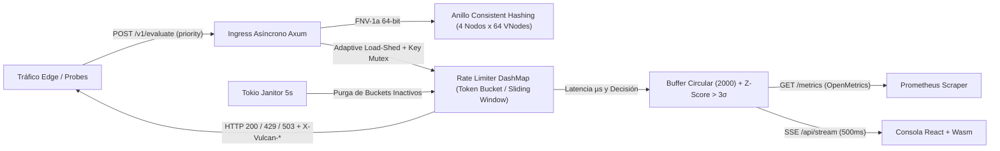

[Read documentation in English](./README.md)

# VULCAN // ENGINE (Release Enterprise V2.0)

**Motor distribuido de Rate-Limiting de ultra-baja latencia, Adaptive Load-Shedding, ingestión de telemetría en tiempo real y detección de anomalías por Z-Score** escrito en **Rust** (`Axum`, `Tokio`, `DashMap`), acompañado de un módulo estadístico en **WebAssembly (`wasm-bindgen`)** y una consola operativa de sala de control en **React + TypeScript**.

---

## Arquitectura del Sistema (V2.0)

```text
                        +-----------------------------------------------------+
  Tráfico HTTP          |           VULCAN // ENGINE V2.0 (Rust)              |
  POST /v1/evaluate --->|  +-------------------+   +-----------------------+  |
  (critical|standard|   |  | Anillo Consistent |   | Rate Limiter DashMap  |  |
   best_effort)         |  | Hashing (FNV-1a)  |-->| con Prioridades y     |  |
                        |  | 64 vnodes / nodo  |   | Adaptive Load-Shed    |  |
                        |  +-------------------+   +-----------+-----------+  |
                        |                                      |              |
                        |  +-----------------------------------v-----------+  |
                        |  | Almacén Telemetría (anillo 2,000 eventos)     |  |
                        |  | • Percentiles µs y Detector Z-Score > 3.0σ    |  |
                        |  | • Tokio Janitor 5s (limpieza LRU de buckets)  |  |
                        |  | • Prometheus /metrics + Stream SSE 500ms      |  |
                        |  +-----------------------+-----------------------+  |
                        +--------------------------|--------------------------+
                                                   |
                                  SSE (500ms) /api/stream
                                                   |
                        +--------------------------v--------------------------+
                        |       Consola React + TypeScript Control Room       |
                        |  • Histograma Wasm 5-Buckets µs + p50/p95/p99/Jitter|
                        |  • Anillo Consistent Hashing + Toggles de Nodos     |
                        |  • Event Trace Drawer + Modal OpenMetrics /metrics  |
                        +-----------------------------------------------------+
```



---

## Componentes Avanzados V2.0

### 1. Adaptive Load-Shedding & Priority Queuing (`backend/src/limiter.rs`)
- **Cero Bloqueos Globales**: `DashMap` + `parking_lot::Mutex` granular por llave y contadores atómicos `AtomicU64`.
- **Niveles de Prioridad (`critical` | `standard` | `best_effort`)**:
  - Cuando se activa `OVERLOAD_SHEDDING` (vía `POST /api/system/overload-guard`, umbral RPS o simulación `POST /api/chaos/overload`):
    - `critical` recibe `2x` de capacidad operativa garantizando continuidad (`HTTP 200`).
    - `standard` se degrada de forma controlada a la mitad de su capacidad (`capacity / 2`).
    - `best_effort` se descarta de inmediato con **`HTTP 503 Service Unavailable`**, header `X-Vulcan-Load-Shed: active` y decisión `SHED_OVERLOAD`, protegiendo la memoria y CPU del clúster.
- **Algoritmos**: **Token Bucket** y **Sliding Window Counter**, en modos `enforce` (`HTTP 429`) y `shadow` (`HTTP 200` + `SHADOW_FLAGGED`).

### 2. Tokio Background Janitor y Telemetría de Memoria (`backend/src/janitor.rs`)
- Tarea asíncrona (`tokio::spawn`) ejecutándose cada **5 segundos** para expulsar buckets inactivos en `DashMap`, compactar ventanas antiguas de anomalías y reportar `keys_evicted_total`, `active_buckets`, `sweeps_completed`, `estimated_memory_kb` y `uptime_secs`.

### 3. Endpoint Nativo Prometheus / OpenMetrics (`GET /metrics`)
- Expone métricas en formato estándar `text/plain; version=0.0.4; charset=utf-8`:
  - `vulcan_requests_total{decision="allowed"|"throttled"|"shadow_flagged"|"shed_overload"}`
  - `vulcan_eval_duration_microseconds{quantile="0.5"|"0.95"|"0.99"}`, `_max`, `_mean`
  - `vulcan_ring_active_nodes`, `vulcan_ring_total_vnodes`
  - `vulcan_active_buckets`, `vulcan_janitor_keys_evicted_total`
  - `vulcan_overload_shedding_active`

### 4. Expansión WebAssembly (`wasm-analytics/src/lib.rs`)
- Exporta `compute_latency_percentiles`, `detect_zscore_anomalies` y `compute_latency_histogram` (5 buckets de microsegundos: `<25µs`, `25-50µs`, `50-100µs`, `100-250µs`, `>250µs`) con puente interoperable en TypeScript.

### 5. Consola de Sala de Control (`frontend/src/`)
- Estética **Carbon & Precision Telemetry** (`#09090B`, superficie `#0C0C0E`, bordes `1px solid rgba(255,255,255,0.07)` y tipografía tabular `JetBrains Mono`).
- Barra superior unificada con estado del **Load Shedding Guard** (`NOMINAL` / `SHEDDING ACTIVE`), modal `/metrics` Prometheus, simuladores **`Normal Traffic`**, **`DDoS Key Spike`** y **`Cascade Overload (503 Shed)`**, histograma Wasm en `µs` y **Event Trace Drawer** al hacer clic sobre cualquier fila de decisión.

---

## Referencia de Endpoints

| Método | Ruta | Descripción |
| :--- | :--- | :--- |
| `GET` | `/health` | Estado del runtime Rust, buckets activos y estado del guard de sobrecarga |
| `GET` | `/metrics` | Métricas nativas Prometheus / OpenMetrics `0.0.4` |
| `POST` | `/v1/evaluate` | Evaluación con prioridad (`{ namespace, key, tokens, algorithm, priority }`) -> `200` / `429` / `503` |
| `POST` | `/v1/ingest/batch` | Ingestión masiva por lotes y barrido Z-Score |
| `GET` | `/api/stream` | Streaming **SSE** (`text/event-stream`) cada `500ms` |
| `GET` / `POST` | `/api/rules` | Listar o crear/actualizar reglas (persistidas atómicamente en disco) |
| `DELETE` | `/api/rules/:namespace` | Eliminar política por namespace |
| `GET` | `/api/cluster/topology` | Topología del anillo Consistent Hashing y distribución por nodo |
| `POST` | `/api/cluster/nodes/:node_id/toggle` | Simula caída o recuperación de nodo calculando `%` exacto reasignado |
| `GET` / `POST` | `/api/system/overload-guard` | Configurar Adaptive Load-Shedding (`enabled`, `max_rps_threshold`, `shed_best_effort`) |
| `POST` | `/api/chaos/burst` | Generador concurrente en Tokio (`mode: "normal" \| "ddos"`) |
| `POST` | `/api/chaos/overload` | Simulador de sobrecarga en cascada activando rechazo `503` para `best_effort` |

---

## Verificación y Pruebas de Carga

### Suite Backend y WebAssembly (27 Pruebas Backend + 5 Pruebas Wasm)
```bash
cargo test --manifest-path backend/Cargo.toml
cargo test --manifest-path wasm-analytics/Cargo.toml
```

### Compilación Frontend
```bash
npm --prefix frontend install
npm --prefix frontend run build
```

### Ejecución Unificada (`0.0.0.0:${PORT:-8080}`)
```bash
cargo run --release --manifest-path backend/Cargo.toml
```

### Docker Multi-Etapa para Render
```bash
docker build -t vulcan-engine:2.0 .
docker run -e PORT=8080 -p 8080:8080 vulcan-engine:2.0
```
