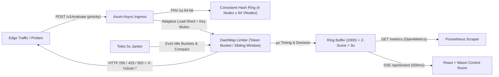

[Leer documentación en Español](./README.es.md)

# VULCAN // ENGINE (Release Enterprise V2.0)

**Ultra-low latency distributed Rate-Limiting, Adaptive Load-Shedding, real-time telemetry ingestion, and Z-Score anomaly detection engine** written in **Rust** (`Axum`, `Tokio`, `DashMap`), paired with a **WebAssembly (`wasm-bindgen`)** statistical analytics module and a high-precision **Control Room Observability UI** in **React + TypeScript**.

---

## System Architecture (V2.0)

```text
                        +-----------------------------------------------------+
  HTTP Ingress          |           VULCAN // ENGINE V2.0 (Rust)              |
  POST /v1/evaluate --->|  +-------------------+   +-----------------------+  |
  (critical|standard|   |  | Consistent Hash   |   | Priority-Aware        |  |
   best_effort)         |  | Ring (FNV-1a 64)  |-->| DashMap Rate Limiter  |  |
                        |  | 64 vnodes / node  |   | + Adaptive Load-Shed  |  |
                        |  +-------------------+   +-----------+-----------+  |
                        |                                      |              |
                        |  +-----------------------------------v-----------+  |
                        |  | Telemetry Store (2,000-event ring buffer)     |  |
                        |  | • Microsecond (µs) percentiles & Z-Score > 3σ |  |
                        |  | • Tokio 5s Janitor (LRU bucket eviction)      |  |
                        |  | • Prometheus /metrics + SSE 500ms stream      |  |
                        |  +-----------------------+-----------------------+  |
                        +--------------------------|--------------------------+
                                                   |
                                  SSE (500ms) /api/stream
                                                   |
                        +--------------------------v--------------------------+
                        |       React + TypeScript Control Room UI            |
                        |  • Wasm 5-Bucket µs Histogram + p50/p95/p99/Jitter  |
                        |  • Consistent Hash Ring Visualizer & Node Toggles   |
                        |  • Event Trace Drawer + OpenMetrics /metrics Modal  |
                        +-----------------------------------------------------+
```



---

## Core Engineering Components

### 1. Adaptive Load-Shedding & Priority Queuing (`backend/src/limiter.rs`)
- **Zero Global Lock Contention**: Uses `DashMap` for concurrent bucket lookup combined with granular per-key `parking_lot::Mutex` and `AtomicU64` telemetry counters.
- **Priority Tiers (`critical` | `standard` | `best_effort`)**:
  - When the Overload Guard enters `OVERLOAD_SHEDDING` (configured via `POST /api/system/overload-guard`, triggered by RPS threshold, or simulated via `POST /api/chaos/overload`):
    - `critical` receives `2x` capacity headroom and guaranteed operational continuity (`HTTP 200`).
    - `standard` scales down gracefully to degraded capacity (`capacity / 2`).
    - `best_effort` is immediately shed with **`HTTP 503 Service Unavailable`**, header `X-Vulcan-Load-Shed: active`, and decision `SHED_OVERLOAD` without exhausting bucket memory.
- **Algorithms**: Selectable per rule between **Token Bucket** (nanosecond continuous refill) and **Sliding Window Counter** (weighted boundary smoothing).
- **Policy Modes**: `enforce` (`HTTP 429`) and `shadow` (`HTTP 200` + `SHADOW_FLAGGED`).

### 2. Tokio Background Janitor & Memory Telemetry (`backend/src/janitor.rs`)
- Runs an asynchronous `tokio::spawn` loop every **5 seconds** to evict expired/idle `DashMap` key buckets, compact stale anomaly cooldown maps, and expose live memory recovery telemetry (`keys_evicted_total`, `active_buckets`, `sweeps_completed`, `estimated_memory_kb`, `uptime_secs`).

### 3. Native Prometheus / OpenMetrics Endpoint (`GET /metrics`)
- Exports Prometheus `text/plain; version=0.0.4; charset=utf-8` metrics:
  - `vulcan_requests_total{decision="allowed"|"throttled"|"shadow_flagged"|"shed_overload"}`
  - `vulcan_eval_duration_microseconds{quantile="0.5"|"0.95"|"0.99"}`, `_max`, `_mean`
  - `vulcan_ring_active_nodes`, `vulcan_ring_total_vnodes`
  - `vulcan_active_buckets`, `vulcan_janitor_keys_evicted_total`
  - `vulcan_overload_shedding_active`

### 4. WebAssembly Statistical Expansion (`wasm-analytics/src/lib.rs`)
- Exports `compute_latency_percentiles`, `detect_zscore_anomalies`, and `compute_latency_histogram` (5 sub-millisecond buckets: `<25µs`, `25-50µs`, `50-100µs`, `100-250µs`, `>250µs` with exact counts and percentages) via `wasm-bindgen`, with an exact IEEE-754 TypeScript fallback bridge.

### 5. Control Room UI (`frontend/src/`)
- Unified `#0C0C0E` structural grid over `#09090B` with `1px solid rgba(255,255,255,0.07)` hairline borders and `JetBrains Mono` `tabular-nums`.
- Includes the interactive **Load Shedding Guard** control (`NOMINAL` / `SHEDDING ACTIVE`), **3 Stress Simulators** (`Normal Traffic`, `DDoS Key Spike`, `Cascade Overload (503 Shed)`), **Wasm µs Latency Histogram**, **Consistent Hashing Ring**, **Prometheus `/metrics` Preview Modal**, and **Event Trace Drawer** (click any row to inspect `FNV-1a` hex hash, priority tier, and full HTTP headers).

---

## Microsecond Performance Characteristics

| Operation | Median (`p50`) | Tail (`p99`) | Complexity |
| :--- | :---: | :---: | :--- |
| Token Bucket / Sliding Window Evaluation | `1.2 – 4.5 µs` | `< 18 µs` | $O(1)$ amortized (`DashMap` + per-key lock) |
| Adaptive Load-Shed Fast Reject (`best_effort`) | `< 0.5 µs` | `< 2 µs` | $O(1)$ lock-free atomic increment |
| Consistent Hash Ring Lookup (256 vnodes) | `0.4 – 1.1 µs` | `< 3 µs` | $O(\log V)$ (`BTreeMap::range`) |

---

## API Reference

| Method | Endpoint | Purpose |
| :--- | :--- | :--- |
| `GET` | `/health` | Engine health, uptime, active buckets, overload shedding state |
| `GET` | `/metrics` | Native Prometheus / OpenMetrics `0.0.4` exposition |
| `POST` | `/v1/evaluate` | Priority-aware evaluation (`{ namespace, key, tokens, algorithm, priority }`) -> `200` / `429` / `503` |
| `POST` | `/v1/ingest/batch` | High-throughput batch ingestion and Z-Score sweep |
| `GET` | `/api/stream` | Server-Sent Events (`text/event-stream`) snapshot push every `500ms` |
| `GET` / `POST` | `/api/rules` | List or upsert rate-limit rules (persisted atomically to disk) |
| `DELETE` | `/api/rules/:namespace` | Remove a namespace policy |
| `GET` | `/api/cluster/topology` | Inspect Consistent Hash Ring vnode segments and node traffic |
| `POST` | `/api/cluster/nodes/:node_id/toggle` | Drop/recover an edge node and compute exact reassigned key `%` |
| `GET` / `POST` | `/api/system/overload-guard` | Read or configure Adaptive Load-Shedding (`enabled`, `max_rps_threshold`, `shed_best_effort`) |
| `POST` | `/api/chaos/burst` | Concurrent Tokio traffic generator (`mode: "normal" \| "ddos"`) |
| `POST` | `/api/chaos/overload` | Cascade overload simulator activating `OVERLOAD_SHEDDING` across priority tiers |

---

## Verification & Load Testing

### Run Backend & Wasm Test Suites (27 Backend Tests + 5 Wasm Tests)
```bash
cargo test --manifest-path backend/Cargo.toml
cargo test --manifest-path wasm-analytics/Cargo.toml
```

### Build Frontend Console
```bash
npm --prefix frontend install
npm --prefix frontend run build
```

### Run Unified Binary (`0.0.0.0:${PORT:-8080}`)
```bash
cargo run --release --manifest-path backend/Cargo.toml
```

### Render Production Multi-Stage Docker Build
```bash
docker build -t vulcan-engine:2.0 .
docker run -e PORT=8080 -p 8080:8080 vulcan-engine:2.0
```
